# Akso Pass 用户手册

> 适用版本：v4.3.3 · 更新日期：2026-11-10 · 面向读者：日常使用者
>
> 本手册只讲「怎么装、点哪里、会得到什么」。技术实现见 `docs/CODEBASE_OVERVIEW.md`，排障见 `docs/DIAG-GUIDE.md`。
>
> 截图中的邮箱、站点、账号均为演示数据，实际使用时替换成你自己的。

---

## 三分钟上手

1. 解压安装包 → `chrome://extensions` → 打开开发者模式 → **加载已解压的扩展程序**。
2. 点扩展图标 → **打开管理页**。
3. 右上角 **登录**（没有账号就在登录页切「注册」）→ 登录后回到管理页。
4. **站点管理**：填站点地址 → 添加。
5. **添加账号**：选站点、填账号名和密码 → **添加并打开**。
6. 以后按 **Alt+Q** 呼出账号轮盘，点一下就能切换到对应账号。

### 常用配置入口

| 想改什么 | 去哪里 |
| --- | --- |
| 登录 / 退出云端账号 | 管理页右上角邮箱菜单 |
| 站点地址、站点名称 | **站点管理** 页签 |
| 盒子分组、禁用、绑定站点 | **盒子管理** 页签 |
| 账号的页签名、账号名、密码、所属盒子 | 账号卡片上的 **编辑 / 移入盒子** |
| 常用页面与排序 | **常用页面** 页签（Alt+1） |
| 快捷键 | `chrome://extensions/shortcuts` |
| 翻译总开关、填充方式、目标语言、引擎 | 左侧 **翻译面板** |
| 扩展版本更新 | `chrome://extensions` 里点刷新 |

---

## 一、安装、更新与第一次打开

### 1.1 安装

1. 把发行包（zip）**解压到一个固定目录**，例如 `D:\Tools\akso-pass`。不要放在「下载」目录，也不要装完就移动或删除——Chrome 每次启动都会从这个目录读取扩展。
2. 打开 Chrome，地址栏输入 `chrome://extensions`（Edge 用 `edge://extensions`）。
3. 打开右上角的 **开发者模式**。
4. 点 **加载已解压的扩展程序**，选择包含 `manifest.json` 的那个文件夹。
5. 在工具栏的扩展图标上点「固定」，方便随时打开。

> 每次启动浏览器时出现「请停用以开发者模式运行的扩展程序」提示，是 Chrome 对手动安装扩展的固定提醒，点关闭即可，不影响使用。

### 1.2 更新

1. 用新版本**覆盖**原安装目录（保留目录路径不变）。
2. 回到 `chrome://extensions`，在 Akso Pass 卡片上点 **刷新**（↻）。
3. 打开扩展弹窗，右上角版本号应与发行包一致。

覆盖安装不会丢数据；账号、站点、盒子都在云端。

### 1.3 第一次打开：先认识弹窗

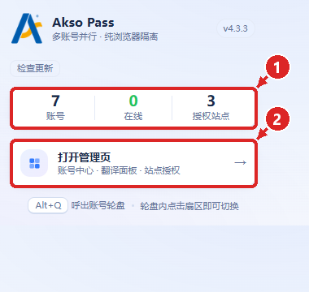

1. **账号 / 在线 / 授权站点**：当前云端账号总数、正在登录的账号数、已授权的站点数。
2. **打开管理页**：进入账号中心。所有添加、编辑、站点、盒子、常用页面都在这里。

弹窗左上角的 **检查更新** 会读取最新发行信息；有新版时出现下载提示。扩展不会自动更新，更新方式见 1.2。

---

## 二、第一次使用：登录、加站点、加账号

### 2.1 登录云端账号库

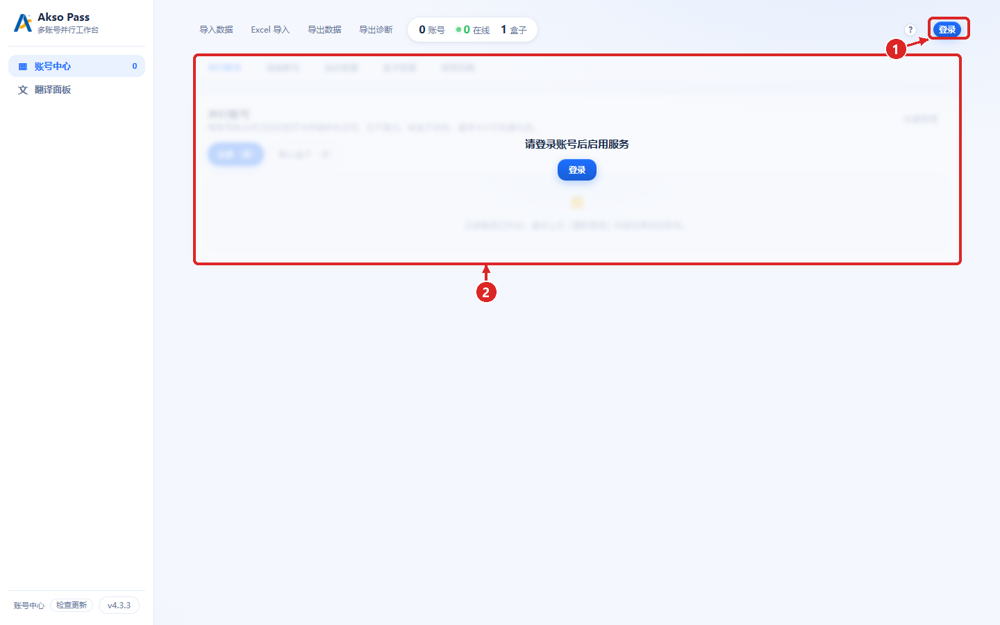

1. 点右上角 **登录**。
2. 主区域会显示「请登录账号后启用服务」的遮罩；登录前不能添加或打开账号。

> 如果首次打开时顶部出现「登录已过期」的红色提示，直接点右上角 **登录** 即可——未登录时这条提示是默认状态，不影响使用。

浏览器会打开 Akso Cloud 的登录/授权页：

- 已有账号：填邮箱、密码 → **登录并授权**。
- **没有账号**：在授权页顶部切到 **注册**，填邮箱、邮箱验证码、密码 → **注册并授权**。注册成功后会自动完成本次授权，**不需要回到扩展再点一次登录**。
- 如果授权码已经过期，页面会提示回到 Akso Pass 重新点「登录」；已注册的账号不会丢。

> 「注册」入口由云端授权页提供，需要云端已更新到对应版本。若你的授权页暂时没有「注册」，请先到 Akso Cloud 首页注册，再回到扩展点「登录」。

登录成功后回到管理页，右上角会显示你的云端邮箱。

### 2.2 添加站点

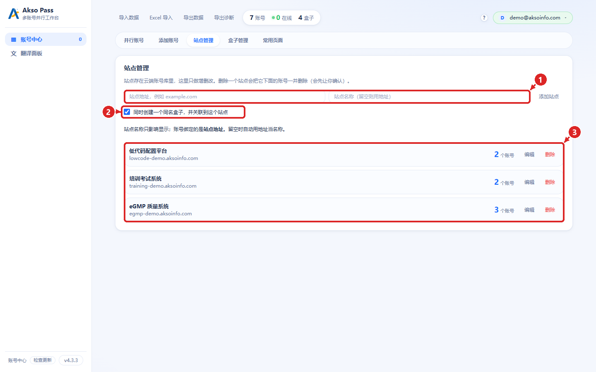

1. **站点地址**：填要使用的系统地址，例如 `https://egmp.example.com` 或内网 `http://10.0.0.8:8080`。**站点名称**可留空，留空时用地址当名称。
2. **同时创建一个同名盒子**：默认勾选。这样站点下的账号会自动归入一个同名盒子，之后在轮盘里可以整组切换。
3. 点 **添加站点**。已添加的站点显示在下方列表，可 **编辑** 名称/地址/备注，或 **删除**（会连同该站点下的账号一起删除，删除前会再次确认）。

第一次打开某个站点时，Chrome 会询问是否允许扩展访问该站点，选择 **允许**。没有授权的站点无法自动登录，只能以普通标签页打开。

### 2.3 添加第一个账号

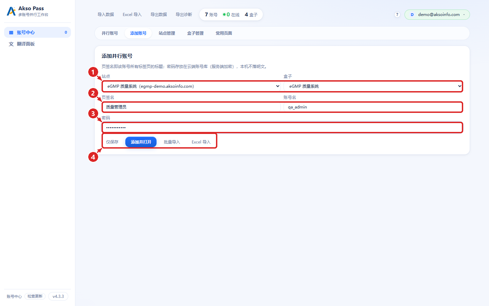

1. **站点 + 盒子**：先选站点，再选盒子。切换站点后盒子会回到「默认盒子」，重新选一次即可。
2. **页签名 + 账号名**：页签名会显示在标签页标题最前面（不填就用账号名）；账号名是登录这个系统用的用户名。
3. **密码**：登录该系统用的密码。密码上传云端账号库（服务端加密），**本机不留口令**，本机只保存账号结构。
4. **仅保存**：只把账号存进云端，不打开页面。**添加并打开**：保存后立即新开标签页并自动填写、登录。

添加成功后回到「并行账号」，卡片状态会变成 **在线**，标签页标题带上页签名，多个账号互不干扰。

---

## 三、管理页总览

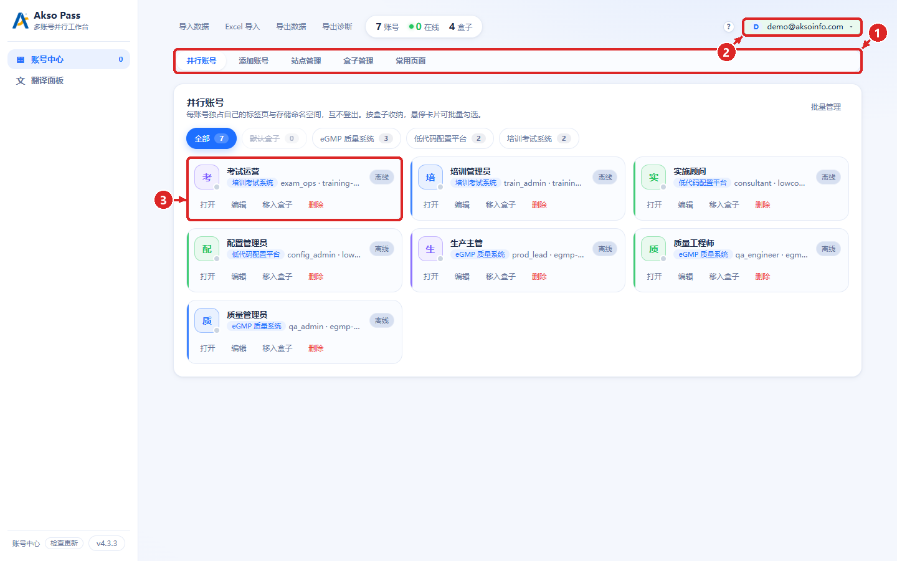

1. **云端账号入口**：显示当前登录邮箱；点开可打开 Akso Cloud、同步数据、退出账号（见第八节）。
2. **五个页签**：并行账号 / 添加账号 / 站点管理 / 盒子管理 / 常用页面。所有功能都从这里进入。
3. **账号卡片**：一张卡 = 一个账号。卡上直接显示页签名、站点、账号名和状态；下方四个动作：
   - **打开**：已开标签页时切过去；没开时新开并自动登录。
   - **编辑**：改页签名、账号名、密码、所属盒子。
   - **移入盒子**：把账号换到另一个盒子（可直接输入新盒子名）。
   - **删除**：关闭这个账号的所有标签页，并从云端删除。

卡片上方的 **盒子筛选条** 只负责筛选视图，不改变账号归属；**批量管理** 用于多选后统一移动或删除。

### 3.1 状态说明

| 状态 | 含义 | 怎么处理 |
| --- | --- | --- |
| **在线** | 该账号至少有一个标签页，且登录态已恢复 | 无需处理 |
| **待登录** | 标签页已打开，但还没完成自动登录 | 点「打开」或在该页手动登录一次 |
| **离线** | 当前没有打开这个账号的标签页 | 点「打开」 |
| **需要重新打开** | 站点授权或页面状态已变化，旧标签页无法继续沿用 | 点「打开」重开一次 |

### 3.2 批量管理

点右上角 **批量管理**，卡片前出现复选框：勾选多个账号后，可以 **移入盒子**、**删除所选** 或 **取消选择**。删除会关闭这些账号的所有标签页，执行前有确认。

---

## 四、添加账号的三种方式

### 4.1 单个添加

见 2.3。适合账号不多、边用边加。

### 4.2 文本批量导入

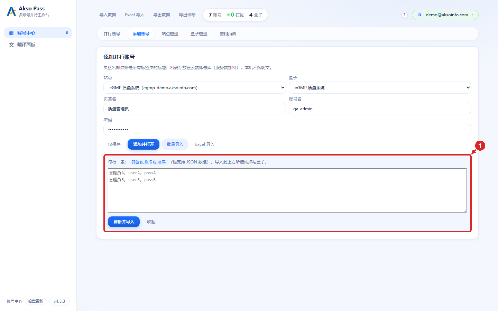

1. 先在表单上方选好 **站点** 和 **盒子**——批量导入的账号都会进这两个位置。
2. 点 **批量导入** 展开输入区，每行一个账号：

   ```text
   页签名,账号名,密码
   质量管理员,qa_admin,QaPass!2026
   质量工程师,qa_engineer,QaPass!2026
   ```

   分隔符支持英文逗号、中文逗号「，」和 Tab；也支持 JSON 数组：

   ```json
   [{"tabName":"质量管理员","username":"qa_admin","password":"QaPass!2026"}]
   ```

3. 点 **解析并导入**。导入的账号只保存，不会自动打开；需要时逐张卡片点「打开」。

### 4.3 Excel 导入

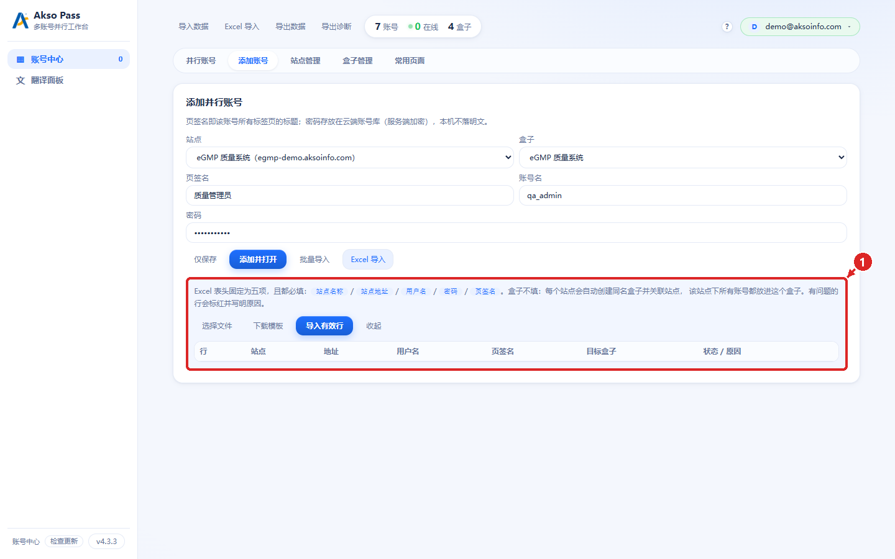

1. 在添加账号页点 **Excel 导入**（顶部工具栏的 **Excel 导入** 是同一个入口）。
2. 点 **下载模板**，按模板填写。表头固定为五项，且都必填：

   | 站点名称 | 站点地址 | 用户名 | 密码 | 页签名 |
   | --- | --- | --- | --- | --- |
   | eGMP 质量系统 | https://egmp.example.com | qa_admin | QaPass!2026 | 质量管理员 |

3. 选择 `.xlsx` / `.xls` / `.csv` 文件后，下方会预览每一行；有问题的行标红并写明原因。
4. 点 **导入有效行**，只创建通过校验的行。每个站点会自动创建一个同名盒子并关联，账号都放进这个盒子。

> 表格里不要合并单元格，也不要在表头前加标题行；第一行必须就是上面五个表头。

---

## 五、站点管理

见 2.2 的截图。补充说明：

- 站点地址支持完整 URL，也支持省略协议；内网 HTTP 地址可用。
- 站点名称只影响显示，账号实际绑定的是站点地址；改地址会让该站点下的账号需要重新打开。
- 删除站点会连带删除它下面的账号，系统会先让你确认；不想删账号时，先把账号移到别的盒子或站点。
- 站点的新增、修改、删除都会同步到云端，没有单独的「手动同步」按钮。

---

## 六、盒子管理

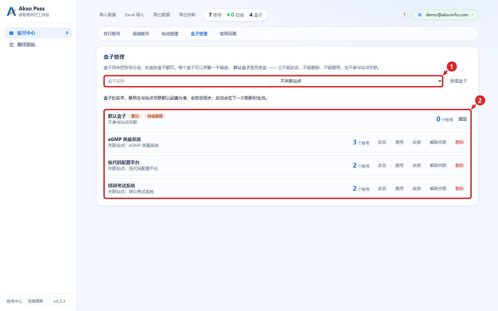

1. **新建盒子**：填盒子名称，可选择关联一个站点，点 **新建盒子**。
2. **盒子列表**：每一行显示账号数、关联站点和可用动作——**改名 / 禁用 / 绑站 / 解除关联 / 删除**。

规则：

- **默认盒子**是兜底盒子：不能改名、不能删除、不能禁用，也不参与站点关联；没有账号时会自动禁用。
- 一个盒子最多关联一个站点；禁用后的盒子不会出现在账号轮盘里，但账号仍在。
- 删除有账号的盒子时，会让你选择「连同账号一起删除」或「把账号移到默认盒子」。
- 盒子的名称、禁用状态、站点关联都以云端为准，扩展会定时刷新；改完稍等几秒即可在其他设备看到。

盒子筛选条（并行账号页顶部）只是视图筛选；要改归属，请用卡片上的「移入盒子」或批量管理。

---

## 七、常用页面

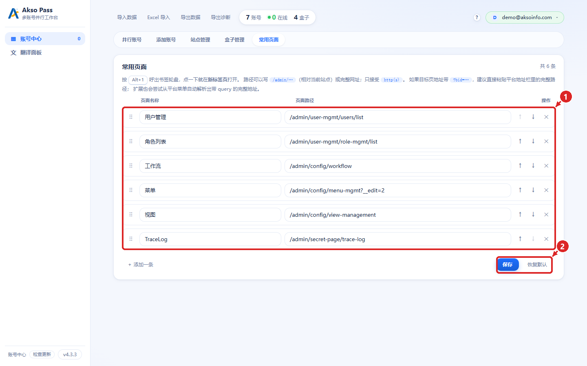

1. **页面列表**：每行一个页面，左侧拖动手柄可排序，右侧 ↑ / ↓ 调整顺序，✕ 删除；点 **＋ 添加一条** 新增。
2. **保存 / 恢复默认**：改完必须点 **保存** 才生效；**恢复默认** 会还原内置的六条页面。

填写规则：

- **页面名称**：显示在轮盘上的名字。
- **页面路径**：可以写相对路径（如 `/admin/user-mgmt/users/list`），也可以写完整 `http(s)://` 地址。
- 只接受 `http(s)`；需要带 `?id=...` 的页面，建议直接粘贴平台地址栏里的完整地址。
- 最多 60 条；按 **Alt+1** 呼出常用页面轮盘，点一条即可用当前账号身份打开。

---

## 八、账号轮盘与页面内快捷键

### 8.1 Alt+Q：账号轮盘

- 在任意已授权站点按 **Alt+Q**，弹出 5×4 的账号网格，一页最多 20 个。
- **单击**卡片即切换/打开该账号；轮盘只支持点击，不支持键盘上下左右选择。
- 卡片上显示账号状态；名称过长会省略，鼠标悬停可看全名。
- 一页放不下时用滚轮、左右箭头或底部圆点翻页；禁用盒子会被跳过。
- 如果当前站点绑定了某个盒子，轮盘会先打开这个盒子；否则从「全部」开始。
- 在 `chrome://` 等受限页面按 Alt+Q，会打开一个独立窗口显示轮盘。

### 8.2 Alt+W：生命周期状态切换

在业务记录详情页按 **Alt+W**，可以直接切换该记录的生命周期状态，不必层层点菜单。只在该站点有生命周期配置时可用。

### 8.3 Alt+2：调试跳转

在配置类页面按 **Alt+2**，可快速跳到对象配置、列表布局、表单布局、关联、生命周期、工作流、菜单等后台页面。这个快捷键由页面内脚本处理，不在 `chrome://extensions/shortcuts` 里。

### 8.4 自定义快捷键

打开 `chrome://extensions/shortcuts`，找到 Akso Pass，可修改：

| 功能 | 默认键 |
| --- | --- |
| 账号轮盘 | Alt+Q |
| 生命周期状态 | Alt+W |
| 常用页面 | Alt+1 |
| 输入翻译 | Ctrl+X |
| 调试跳转 | Alt+2（页面内处理，不可在此改） |

若显示「未设置」，说明被其他扩展占用，点输入框重新按一次即可。

---

## 九、翻译面板

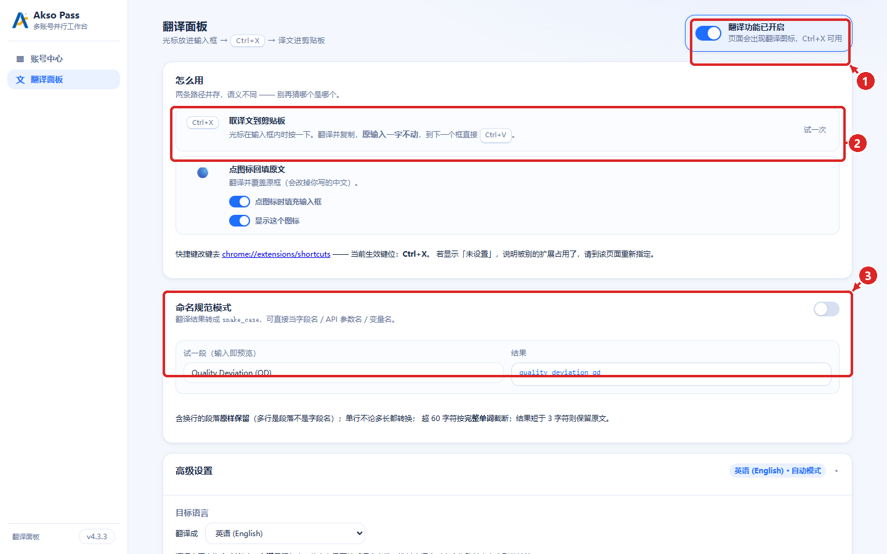

1. **总开关**：关闭后页面不再出现翻译图标，Ctrl+X 也不生效。
2. **Ctrl+X 取译文到剪贴板**：光标在输入框里时按 Ctrl+X，扩展把当前输入翻译成目标语言并复制到剪贴板，**原输入不变**；到下一个输入框直接 Ctrl+V。
3. **命名规范模式**：开启后，译文会转成 `snake_case`，适合直接当字段名、API 参数名或变量名。

其他可调项：

- **点图标时填充输入框**：默认开启，点页面上的翻译图标会把译文覆盖进当前输入框；关闭后只复制到剪贴板，不改输入。
- **显示这个图标**：控制页面上是否显示悬浮翻译图标。
- **目标语言 / 翻译引擎**：在「高级设置」里选择；引擎包括腾讯、有道、MyMemory、Lingva 等。
- **快捷键改键**：面板里的链接会打开 `chrome://extensions/shortcuts`。

隐私提醒：翻译内容会发送给所选第三方翻译服务，涉密内容请先确认是否允许外发。

---

## 十、云端账号库与多设备

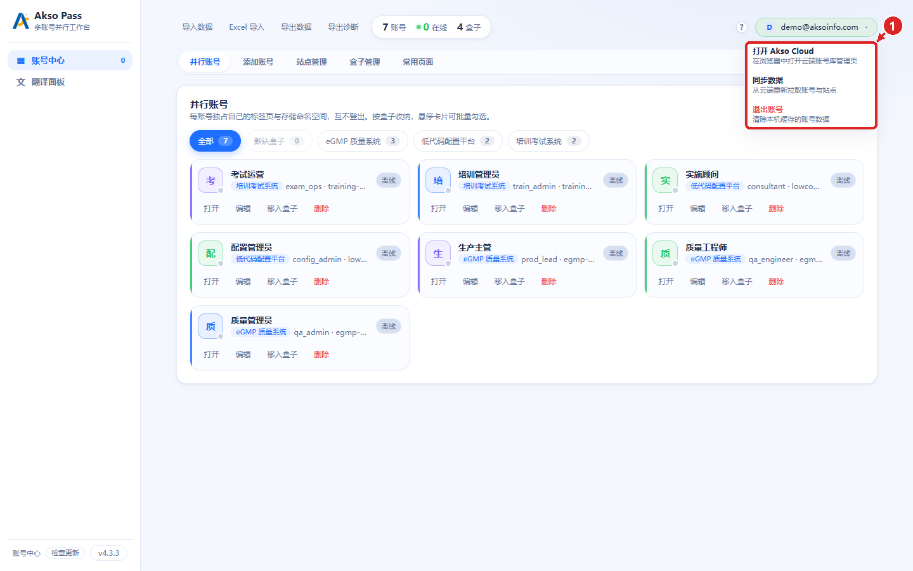

点右上角邮箱旁的箭头，打开云端菜单：

1. **打开 Akso Cloud**：在浏览器里打开云端账号库管理页，可查看账号、站点、盒子，修改密码等。
2. **同步数据**：从云端重新拉取账号、站点、盒子；换电脑或网页端改过数据后点一下。
3. **退出账号**：清除本机保存的登录令牌和账号缓存；云端数据不动，重新登录即可恢复。

账号、站点、盒子都以云端为准；本机只是缓存。换一台电脑安装扩展、登录同一个云端账号，数据会自动回来。

---

## 十一、数据与安全

- **平台密码只存云端**：密码上传云端账号库，由服务端用 Fernet 加密保存；**本机不留口令**，本机只保存账号列表等元数据。
- **登录令牌**：云端登录令牌保存在扩展的本地存储中，有效期由云端会话策略控制；退出账号会立即清除本机令牌。
- **导出数据不含任何口令**：导出的 JSON 只有站点、盒子、页签名、账号名等结构信息，**不含口令、也不含任何解密种子**。
- **导入数据也不含密码**：导入后账号结构会恢复，但密码为空；需要补填密码或重新从云端同步。
- **站点隔离**：扩展只对已授权的站点生效；每个账号的标签页、Cookie、存储相互隔离。
- **最小权限**：站点访问权限按站点授予；不使用时可到 `chrome://extensions` 的「网站访问权限」里收回。

---

## 十二、常见问题

**Q1：更新后还是旧界面？**
没有点扩展页的刷新按钮。到 `chrome://extensions` 点 Akso Pass 卡片上的 ↻，再重新打开管理页。

**Q2：一个账号能开多个标签页吗？**
可以。在已登录的标签页里用系统自己的「新标签页」或站内链接打开，会继承当前账号；手动按 Ctrl+T 新建的空白页不会继承，需要从账号卡片或轮盘打开。

**Q3：弹窗里显示 0 个账号？**
先看右上角是否已登录；未登录时数据不可用。已登录仍为 0，点云端菜单的 **同步数据**。

**Q4：卡片显示「需要重新打开」？**
站点授权或页面状态变了。点卡片上的 **打开** 重开一次；仍不行就到 `chrome://extensions` 检查该站点的访问权限。

**Q5：登录 Cloud 时没有账号怎么办？**
在授权页顶部切到 **注册**，注册成功后会自动完成授权，不需要回扩展再点一次。

**Q6：退出云端账号会影响已经打开的业务账号吗？**
不会。退出只清除本机云端令牌和账号缓存，已经打开的标签页继续可用；重新登录后数据恢复。

**Q7：内网 HTTP 站点能用吗？**
可以。添加站点时填 `http://` 地址即可；首次打开需允许扩展访问该站点。

**Q8：删除盒子后账号去哪了？**
删除时会让你选择：连同账号一起删除，或把账号移到默认盒子。选后者不会丢账号。

**Q9：换电脑后数据还在吗？**
在。登录同一个云端账号即可同步；本机导出/导入只用于迁移结构，不含密码。

**Q10：Alt+Q 没反应？**
先确认当前页面是已授权站点；`chrome://`、扩展商店等受限页面会改为弹出独立窗口。仍无反应，到 `chrome://extensions/shortcuts` 检查快捷键是否被占用。

---

## 十三、已知边界

- **Web Worker 内的 IndexedDB** 不受标签页隔离，依赖 Worker 存储的站点可能串数据。
- 下载页的「继续下载 / 重试」由浏览器接管，扩展拿不到标签页上下文，可能落到默认浏览器身份。
- 未授权站点按 Alt+Q 会退回独立窗口，而不是在当前页打开。
- 带 `noopener` 打开的弹窗无法继承账号身份。
- 一个盒子超过 20 个账号时，轮盘需要滚动查看。
- 翻译只处理可编辑的文本输入框；`chrome://` 页面、扩展商店、未授权的 `file://` 页面不可用。

---

## 附：术语

| 术语 | 含义 |
| --- | --- |
| 站点 | 一个业务系统的地址，例如 `https://egmp.example.com` |
| 盒子 | 账号分组；可绑定一个站点，轮盘按盒子翻页 |
| 页签名 | 显示在标签页标题前的短名，用来区分同一系统的不同账号 |
| 授权站点 | 已允许扩展访问、可自动登录的站点 |
| 云端账号库 | Akso Cloud 上的账号、站点、盒子数据 |
